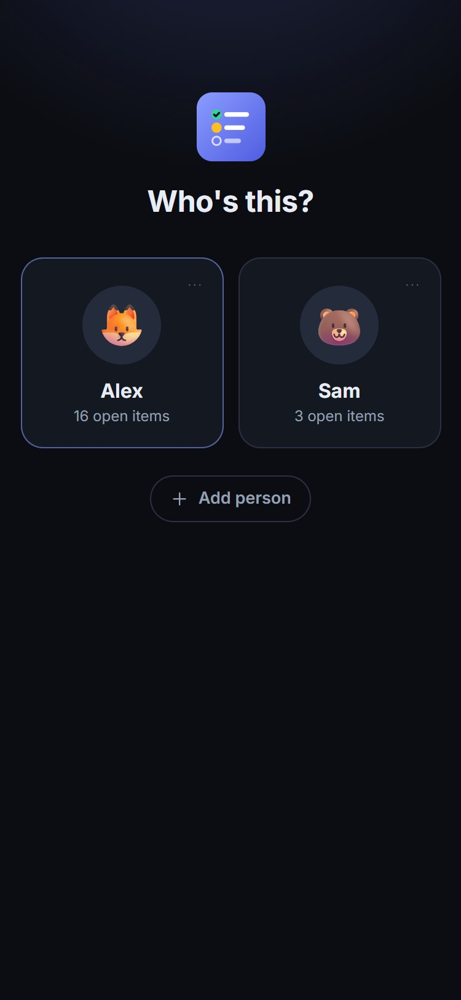
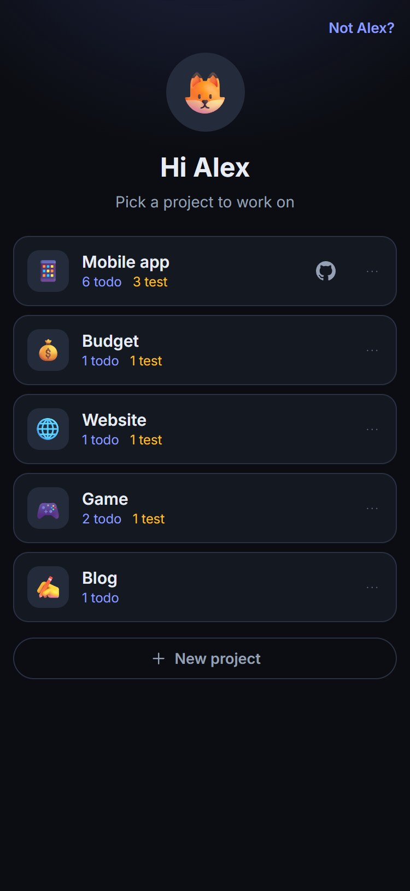
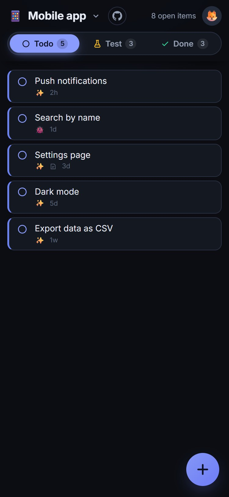
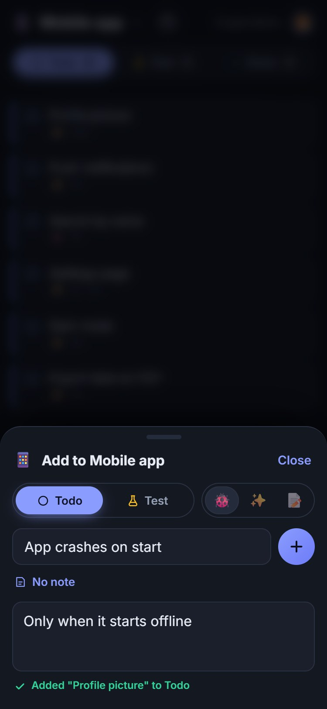
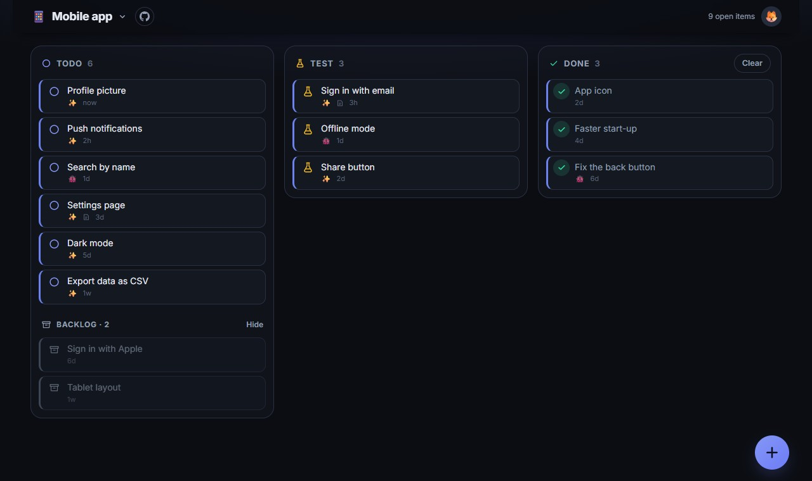

# Project Tracker

A to-do and ready-to-test tracker for every project you're working on, as a Home Assistant add-on.

<p>
  
  
  
  
</p>
<p>
  
</p>

## Installation

Add this repository to Home Assistant:

1. Go to **Settings** → **Add-ons** → **Add-on Store**
2. Click menu (⋮) → **Repositories**
3. Add: `https://github.com/christina-thd/project-tracker`
4. Install **Project Tracker** from the store

## Add-ons

### Project Tracker

Keep track of what's to do and what's ready to test, per project.

**Features:**
- Everyone has their own projects, each with an emoji and a link to its GitHub repo
- **Todo**, **Test** and **Done** lists; one tap moves an item along
- Quick add: tap +, type, and the next one
- Notes and 🐞 bug / ✨ feature / 📝 other on any item
- Phone and PC, live on every screen

[Documentation →](./project-tracker/README.md)

## Development

The app is plain Node.js with no build step and no dependencies. See
[project-tracker/docs/DEVELOPMENT.md](./project-tracker/docs/DEVELOPMENT.md).

```sh
cd project-tracker
npm test
npm run dev
```
